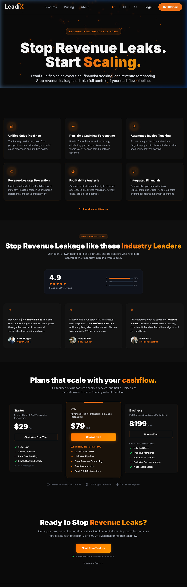
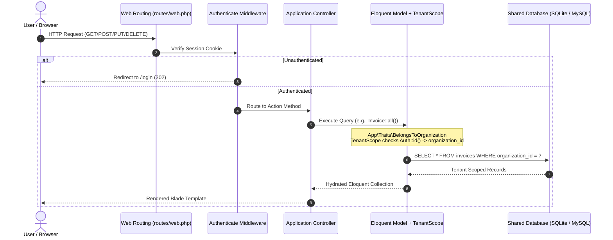
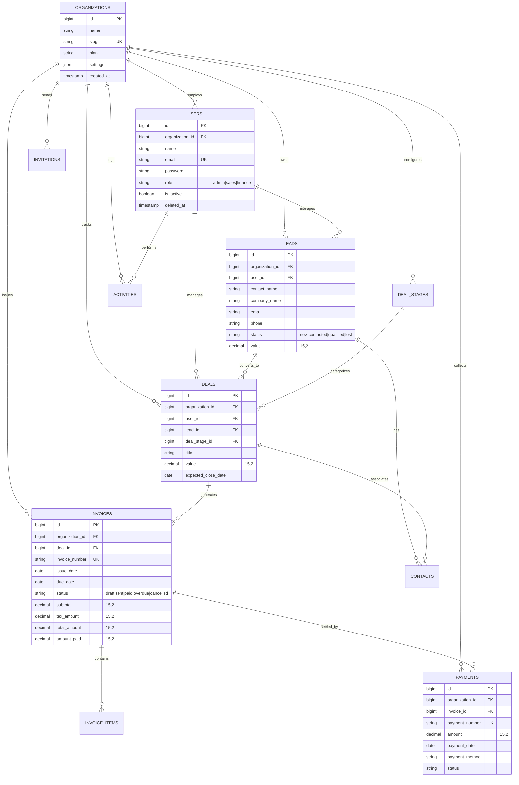

# Leadix CRM

[](https://laravel.com)
[](https://php.net)
[](https://tailwindcss.com)
[](https://alpinejs.dev)
[](https://vitejs.dev)
[](LICENSE)

Leadix is a multi-tenant Customer Relationship Management (CRM) and revenue pipeline platform engineered with Laravel 12, PHP 8.2+, Tailwind CSS, and Alpine.js. Designed for small-to-medium business workflows, the system bridges lead acquisition, Kanban deal pipelines, automated invoice generation upon deal closure, payment tracking, and cash flow reporting within a unified tenant organization structure.

> **Portfolio Project Notice**: Leadix is developed by Ali Harti as an engineering portfolio demonstration run in a local development environment. It showcases multi-tenancy implementation patterns, database schema design, and financial workflows in modern Laravel. It is not currently hosted in a certified production cloud environment.

---

## Screenshot



---

## Features and Functional Modules

| Module | Core Capabilities | Primary Controllers and Services |
| :--- | :--- | :--- |
| **Lead Management** | Capture prospects, manage contact status (`new`, `contacted`, `qualified`, `lost`), convert qualified leads into active deals with customer contact details. | `app/Http/Controllers/LeadController.php`<br>`app/Models/Lead.php` |
| **Deal Pipeline (Kanban)** | Interactive multi-stage drag-and-drop sales funnel (`Lead In`, `Contact Made`, `Needs Defined`, `Proposal Sent`, `Negotiation`, `Won`, `Lost`). Automated trigger creates invoices upon stage transition to "Won". | `app/Http/Controllers/DealController.php`<br>`app/Observers/DealObserver.php`<br>`app/Models/Deal.php` |
| **Invoice Generation** | Automatic invoice numbering (`INV-YYYYMMDD-XXXX`), line-item tax and subtotal calculations, PDF generation via `Barryvdh\DomPDF`, payment status tracking (`draft`, `sent`, `paid`, `overdue`, `cancelled`). | `app/Http/Controllers/InvoiceController.php`<br>`app/Services/InvoicePdfService.php`<br>`app/Models/Invoice.php` |
| **Payment Tracking** | Record full and partial customer remittances, payment method classification (`bank_transfer`, `check`, `credit_card`, `cash`), payment event observers, activity feeds. | `app/Http/Controllers/PaymentController.php`<br>`app/Observers/PaymentObserver.php`<br>`app/Models/Payment.php` |
| **Cash Flow & Analytics** | Executive dashboard aggregating monthly recurring revenue, pending receivables, overdue exposure, historical invoice cash flow trends, and expense records. | `app/Http/Controllers/DashboardController.php`<br>`app/Http/Controllers/CashflowController.php` |
| **Tenant & Team Administration** | Organization profile configuration, user invitations with cryptographic expiration tokens, role assignment (`admin`, `sales`, `finance`), and member management. | `app/Http/Controllers/Settings/OrganizationController.php`<br>`app/Http/Controllers/InvitationController.php` |

---

## System Architecture

### Request Flow and Tenant Resolution



### Entity-Relationship Diagram (ERD)



---

## Security

### Threat Model (STRIDE)

| Threat Category | Potential Threat | Leadix Mitigation / Current Status | Implementation Location |
| :--- | :--- | :--- | :--- |
| **Spoofing** | Attacker impersonates legitimate tenant user or hijacks active web session. | Session ID regeneration on authentication; password hashing via Bcrypt work factor 12; login throttle limits brute-force attempts. | `app/Http/Requests/Auth/LoginRequest.php`<br>`app/Http/Controllers/Auth/AuthenticatedSessionController.php` |
| **Tampering** | User alters invoice totals, payment records, or crosses organization foreign keys. | Mass assignment protection via `$fillable` models; financial calculation fields validated in Form Requests; `TenantScope` enforces `organization_id` on model persistence. | `app/Models/Invoice.php`<br>`app/Models/Payment.php`<br>`app/Traits/BelongsToOrganization.php` |
| **Repudiation** | Action accountability missing when invoices are created, payments logged, or deals modified. | Automated event observers (`DealObserver`, `PaymentObserver`) log state changes to the `activities` table. | `app/Observers/DealObserver.php`<br>`app/Observers/PaymentObserver.php` |
| **Information Disclosure** | Cross-tenant data leakage through unconstrained queries, raw joins, or debug endpoints. | Global Eloquent query scoping restricts reads by `organization_id`. Note: unauthenticated context and query builder joins bypass scope. | `app/Models/Scopes/TenantScope.php`<br>`routes/debug.php` |
| **Denial of Service** | Resource exhaustion via high-frequency login brute forcing or memory-intensive PDF compilation. | Rate limiting middleware applied to authentication endpoints (`5 attempts / minute`). PDF generation performed on demand. | `routes/auth.php`<br>`app/Http/Requests/Auth/LoginRequest.php` |
| **Elevation of Privilege** | Sales representative performs administrative functions or invites users with `admin` privileges. | Custom role assertions (`hasRole()`) in controller actions. Note: dedicated Laravel Policy classes are currently missing. | `app/Models/User.php`<br>`app/Http/Controllers/InvoiceController.php` |

---

### Multi-Tenancy Isolation Model

Leadix employs a **shared-database, shared-schema** multi-tenancy model. Every organization represents an isolated tenant with a primary key in `organizations`.

#### Enforcement Mechanism
1. **Global Eloquent Scope**: Models implementing `App\Traits\BelongsToOrganization` register `App\Models\Scopes\TenantScope`.
2. **Read Scoping**: Whenever an Eloquent query executes, `TenantScope` appends `WHERE organization_id = Auth::user()->organization_id`.
3. **Write Scoping**: The trait hooks into the `creating` Eloquent model event:
   ```php
   static::creating(function ($model) {
       if (auth()->check() && ! $model->organization_id) {
           $model->organization_id = auth()->user()->organization_id;
       }
   });
   ```

#### Scoped vs. Unscoped Models
* **Scoped Models (`App\Traits\BelongsToOrganization`)**:
  * `Activity` (`app/Models/Activity.php`)
  * `Deal` (`app/Models/Deal.php`)
  * `DealStage` (`app/Models/DealStage.php`)
  * `Invoice` (`app/Models/Invoice.php`)
  * `Lead` (`app/Models/Lead.php`)
  * `Payment` (`app/Models/Payment.php`)
* **Unscoped Models**:
  * `User` (`app/Models/User.php`) — Belongs to organization via foreign key, but lacks global scope. Querying `User::all()` returns users across all organizations.
  * `Contact` (`app/Models/Contact.php`) — Table schema lacks an `organization_id` foreign key entirely (`database/migrations/2025_12_21_124203_create_contacts_table.php`).
  * `Expense` (`app/Models/Expense.php`) — Table schema lacks `organization_id`; records are global to the database.
  * `InvoiceItem` (`app/Models/InvoiceItem.php`) — Relies solely on parent `Invoice` foreign key.
  * `Invitation` (`app/Models/Invitation.php`) — Schema contains `organization_id`, but model lacks `BelongsToOrganization` trait.

---

### Authentication and Session Management

* **Guard Type**: Standard Laravel web guard utilizing secure cookie-based session identifiers backed by the `database` session driver (`config/session.php`).
* **Session Lifetime**: 120 minutes of inactivity (`SESSION_LIFETIME=120`). Sessions regenerate IDs upon successful login and invalidate upon logout (`AuthenticatedSessionController.php`).
* **Password Hashing**: Bcrypt password hashing configured at cost factor 12 (`BCRYPT_ROUNDS=12` in `.env.example`).
* **Login Throttling**: Implemented via Laravel's `RateLimiter` in `App\Http\Requests\Auth\LoginRequest`. Locks authentication attempts for 60 seconds after 5 consecutive failures, keyed by client IP and normalized email.
* **Email Verification & Password Reset**: Endpoints are currently commented out in `routes/auth.php`. Password updates occur directly through profile settings.

---

### Authorization and RBAC Matrix

Role-Based Access Control is enforced through a custom role attribute on the `User` model (`admin`, `sales`, `finance`). Controllers inspect roles imperatively via `$user->hasRole($role)` or helper checks.

| Resource / Action | Admin | Sales | Finance | Enforcement File |
| :--- | :---: | :---: | :---: | :--- |
| **Organization Settings** (Update organization profile, manage billing) | Read/Write | Denied | Denied | `app/Http/Controllers/Settings/OrganizationController.php` |
| **Team Management** (Invite members, revoke memberships) | Read/Write | Denied | Denied | `app/Http/Controllers/InvitationController.php` |
| **Lead Operations** (View, create, edit, delete leads) | Read/Write | Read/Write | Read/Write | `app/Http/Controllers/LeadController.php` |
| **Deal Pipeline** (View Kanban, drag stages, close deals) | Read/Write | Read/Write | Read-Only | `app/Http/Controllers/DealController.php` |
| **Invoice Creation & Updates** (Generate invoices, edit terms) | Read/Write | Denied | Read/Write | `app/Http/Controllers/InvoiceController.php` |
| **Invoice PDF Download** (Export compiled invoice PDFs) | Read/Write | Denied | Read/Write | `app/Http/Controllers/InvoiceController.php` |
| **Payment Registration** (Record customer remittances) | Read/Write | Denied | Read/Write | `app/Http/Controllers/PaymentController.php` |
| **Cash Flow & Finance Reports** (View revenue and receivables) | Read/Write | Denied | Read/Write | `app/Http/Controllers/CashflowController.php` |

---

### OWASP Top 10 Mapping

| OWASP Risk Category | Leadix Implementation | Verification Status | File Reference |
| :--- | :--- | :---: | :--- |
| **A01: Broken Access Control** | Global tenant query scoping restricts multi-tenant record access. However, lack of Laravel Policy classes allows potential horizontal privilege escalation where validation rules use global `exists:table,id`. | 🟡 Partial | `app/Models/Scopes/TenantScope.php`<br>`app/Http/Controllers/InvoiceController.php` |
| **A02: Cryptographic Failures** | Passwords hashed using standard Bcrypt (`rounds=12`). Session identifiers are cryptographically pseudo-random. Encryption at rest for PII (phone, tax ID) is not enabled. | 🟡 Partial | `config/hashing.php`<br>`app/Models/User.php` |
| **A03: Injection** | Database queries use Laravel Eloquent ORM and PDO prepared statements with strict parameter binding. Raw unparameterized SQL queries are not used in application controllers. | ✅ Implemented | `app/Http/Controllers/` |
| **A04: Insecure Design** | Separation between sales and finance functions; deals convert to invoices on close. Missing explicit database locking on payment registration exposes concurrent double payments. | 🟡 Partial | `app/Observers/DealObserver.php`<br>`app/Http/Controllers/PaymentController.php` |
| **A05: Security Misconfiguration** | `.env.example` provides safe development placeholders. Production deployments require setting `APP_DEBUG=false`. Default debug route exposes notifications. | 🟡 Partial | `.env.example`<br>`routes/debug.php` |
| **A06: Vulnerable Components** | Dependencies managed through Composer and npm. Project runs on modern Laravel 12 with security-supported framework packages. | ✅ Implemented | `composer.json`<br>`package.json` |
| **A07: Identification & Auth Failures** | Login rate limiting enforces 5 attempts per minute. Session invalidation on logout. MFA / 2FA is currently not implemented. | 🟡 Partial | `app/Http/Requests/Auth/LoginRequest.php` |
| **A08: Software & Data Integrity** | Database seeders use structured models. Form Requests validate input data structures before persistence. Package dependencies verified via `composer.lock`. | ✅ Implemented | `composer.lock`<br>`app/Http/Requests/` |
| **A09: Security Logging & Monitoring** | Audit trail of deal transitions and payment completions logged to the `activities` table. Structured application logging routed to `storage/logs/laravel.log`. | 🟡 Partial | `app/Observers/DealObserver.php`<br>`app/Observers/PaymentObserver.php` |
| **A10: Server-Side Request Forgery** | Application does not accept arbitrary external URLs for backend server-to-server HTTP requests. | ✅ Implemented | `app/Http/Controllers/` |

---

### Financial Data Integrity and Audit Trail

* **Decimal Currency Precision**: All currency and monetary fields (`value`, `subtotal`, `tax_amount`, `total_amount`, `amount_paid`, `amount`) are strictly defined as `DECIMAL(15, 2)` across database migrations (`database/migrations/2024_01_01_000004_create_revenue_pipeline_tables.php`, `database/migrations/2024_01_01_000005_create_finance_tables.php`), preventing floating-point rounding errors.
* **Double-Payment Protection**:
  * Status: 🔲 Planned.
  * Current implementation: `PaymentController@store` records payment rows and updates status, but does not execute inside a database transaction (`DB::transaction`) or utilize row-level locking (`lockForUpdate()`), creating a potential race condition under concurrent requests.
* **Audit Trail**:
  * Status: 🟡 Partial.
  * Current implementation: The `Activity` model records pipeline movements and payment logs. However, invoice line-item modifications and invoice deletions do not write immutable audit entries.

---

### Input Validation, Mass Assignment, and Output Encoding

* **Mass Assignment Protection**: All Eloquent models declare explicit `$fillable` arrays. No model utilizes unconstrained `$guarded = []`.
* **Form Request Validation**: Key business operations (`LoginRequest`, `InvoiceRequest`, `StoreLeadRequest`) validate incoming fields before controller processing.
* **Cross-Site Request Forgery (CSRF)**: All state-changing web routes (`POST`, `PUT`, `DELETE`) pass through `Illuminate\Foundation\Http\Middleware\ValidateCsrfToken`. Forms in Blade templates embed `@csrf` tokens.
* **Output Encoding & XSS Prevention**: Blade templates use standard mustache escaping (`{{ $var }}`) to sanitize HTML special characters. Raw unescaped output (`{!! $var !!}`) is strictly restricted to pre-sanitized UI icons or internal status badges.

---

### Secrets, Configuration, and Deployment Hardening

| Hardening Requirement | Current Configuration | Production Recommendation |
| :--- | :--- | :--- |
| **Environment Configuration** | Tracked `.env.example` contains only non-sensitive placeholders. Actual `.env` is ignored. | Keep `.env` strictly outside source control; inject secrets via CI/CD environment secrets. |
| **Debug Mode (`APP_DEBUG`)** | Set to `true` in local environment. | MUST be set to `false` in production to prevent stack trace disclosures. |
| **HTTPS Enforcement** | Runs over HTTP locally (`http://localhost:8000`). | Force TLS/HTTPS in `AppServiceProvider.php` via `URL::forceScheme('https')`. |
| **HTTP Security Headers** | Default Laravel middleware stack. | Add custom middleware for `Content-Security-Policy`, `X-Frame-Options: SAMEORIGIN`, `X-Content-Type-Options: nosniff`. |
| **Database Encryption** | Plaintext database storage. | Implement column-level encryption (`casts => ['tax_id' => 'encrypted']`) for sensitive client PII. |

---

### Testing Summary

| Test Domain | Current Coverage | Status |
| :--- | :--- | :---: |
| **Basic Framework Smoke Test** | `tests/Feature/ExampleTest.php` checks `/` returns status 200. | ✅ Implemented |
| **Tenant Isolation Tests** | Verification that User A cannot read, update, or delete User B's deals/invoices across organizations. | 🔲 Planned |
| **RBAC Authorization Tests** | Verification that `sales` role cannot access financial reports or create invoices. | 🔲 Planned |
| **Financial Calculations Tests** | Automated assertions for invoice tax arithmetic and payment balance deductions. | 🔲 Planned |

---

### Hardening Roadmap

* 🔲 **H-01: Patch Scope Leak in `Invoice::scopeFilterByOverdue`**: Enclose the `orWhere` condition inside a parameter grouping closure to prevent bypassing `organization_id`.
* 🔲 **H-02: Implement Laravel Policy Layer**: Generate and register dedicated Policy classes (`LeadPolicy`, `DealPolicy`, `InvoicePolicy`, `PaymentPolicy`) binding controller checks to `Authorize` middleware.
* 🔲 **H-03: Scope Unscoped Models**: Add `organization_id` foreign keys and `BelongsToOrganization` trait to `Contact`, `Expense`, and `User` models.
* 🔲 **H-04: Scope Validation Rules**: Replace global `exists:deals,id` with rule closures restricting `exists` queries to the authenticated tenant: `Rule::exists('deals', 'id')->where('organization_id', auth()->user()->organization_id)`.
* 🔲 **H-05: Wrap Financial Mutations in DB Transactions**: Wrap invoice creation, invoice item creation, and payment allocations in `DB::transaction()`.
* 🔲 **H-06: Remove Development Debug Routes**: Restrict or remove `routes/debug.php` prior to production deployment.
* 🔲 **H-07: Implement Test Suite**: Author automated PHPUnit/Pest tests covering cross-tenant boundaries and RBAC matrix.

---

### Known Limitations

1. **Top-Level `orWhere` Query Bleed**: In `app/Models/Invoice.php` (lines 49-56), `scopeFilterByOverdue` applies `->orWhere('due_date', '<', now()->toDateString())` without a nested logical group. In SQL, this creates a query where overdue condition bypasses the `WHERE organization_id = ?` clause, causing overdue invoices across all tenants to be visible.
2. **Cross-Tenant IDOR in Form Requests**: Controllers validating related records (e.g., `'deal_id' => 'required|exists:deals,id'`) validate presence in the global database rather than scoping to the caller's organization. An authenticated user in Tenant A can associate their invoice with a Deal ID belonging to Tenant B.
3. **Cross-Tenant User Enumeration**: `DealController@kanban` executes `\App\Models\User::all(['id', 'name'])`, passing all user names and identifiers across the entire system to the frontend view.
4. **Lack of Dedicated Laravel Policies**: Authorization logic relies on ad-hoc controller assertions rather than centralized, tested Laravel Policy classes.
5. **No Database Transactions on Invoices**: `InvoiceController@store` creates the parent `Invoice` and then iterates over `InvoiceItem` records. If an item fails validation or database constraint, the parent invoice remains orphaned.

---

## Quick Start

### Prerequisites
* **PHP**: 8.2 or higher
* **Composer**: 2.x
* **Node.js**: 18.x or higher
* **SQLite / MySQL**: SQLite (default local) or MySQL 8.0+

### Step-by-Step Installation

1. **Clone the repository**:
   ```bash
   git clone https://github.com/ali-harti/Leadix-App.git
   cd Leadix-App
   ```

2. **Install PHP and Node dependencies**:
   ```bash
   composer install
   npm install
   ```

3. **Configure the environment**:
   ```bash
   cp .env.example .env
   php artisan key:generate
   ```

4. **Prepare the database (SQLite)**:
   ```bash
   # Create the SQLite database file
   touch database/database.sqlite
   # On Windows PowerShell:
   # New-Item -ItemType File -Force -Path database/database.sqlite

   # Execute database migrations and seed sample demo data
   php artisan migrate --seed
   ```

5. **Build frontend assets**:
   ```bash
   npm run build
   # Or run Vite development watcher:
   # npm run dev
   ```

6. **Serve the application**:
   ```bash
   php artisan serve
   ```
   Navigate to `http://localhost:8000` in your browser.

7. **Run test suite**:
   ```bash
   php artisan test
   ```

---

## Environment Variables

| Variable | Required | Default / Example | Purpose |
| :--- | :---: | :--- | :--- |
| `APP_NAME` | Yes | `Leadix` | Name of the application displayed in UI and emails. |
| `APP_ENV` | Yes | `local` | Application environment (`local`, `production`, `testing`). |
| `APP_KEY` | Yes | Generated by `artisan key:generate` | 32-character AES-256 encryption key for sessions and tokens. |
| `APP_DEBUG` | Yes | `true` (local) / `false` (prod) | Toggle framework debug mode and stack trace output. |
| `APP_URL` | Yes | `http://localhost:8000` | Canonical root URL used for link and asset generation. |
| `DB_CONNECTION` | Yes | `sqlite` | Database driver (`sqlite`, `mysql`, `pgsql`). |
| `DB_DATABASE` | Optional | `database/database.sqlite` | Path to SQLite file or database name if using MySQL. |
| `SESSION_DRIVER` | Yes | `database` | Storage driver for session state (`database`, `cookie`, `redis`). |
| `SESSION_LIFETIME` | Yes | `120` | Inactivity session timeout in minutes. |
| `BCRYPT_ROUNDS` | Yes | `12` | Cost factor for Bcrypt password hashing algorithm. |
| `LOG_CHANNEL` | Yes | `stack` | Active logging handler channel (`stack`, `single`, `daily`). |
| `LOG_LEVEL` | Yes | `debug` (local) / `error` (prod) | Minimum logging threshold before recording events. |

---

## Technology Stack

| Layer | Technology | Version | Purpose |
| :--- | :--- | :--- | :--- |
| **Backend Framework** | Laravel | 12.x | Application framework, routing, ORM, and dependency injection. |
| **Runtime Engine** | PHP | ^8.2 | Server-side execution engine. |
| **Database** | SQLite / MySQL | 3.x / 8.0+ | Relational data persistence with foreign key constraints. |
| **Frontend Styling** | Tailwind CSS | ^3.4.17 | Utility-first CSS styling system. |
| **Frontend JavaScript** | Alpine.js | ^3.14.8 | Reactive client-side UI behavior and micro-interactions. |
| **UI Interactivity** | SortableJS | ^1.15.6 | Drag-and-drop Kanban pipeline management. |
| **PDF Generation** | DomPDF (`barryvdh/laravel-dompdf`) | ^3.1 | Server-side HTML-to-PDF rendering for client invoices. |
| **Asset Bundler** | Vite | ^6.0 | Modern frontend build tool and asset bundler. |

---

## Project Structure

```text
Leadix-App/
├── app/
│   ├── Http/
│   │   ├── Controllers/          # Request handlers (Leads, Deals, Invoices, Payments)
│   │   ├── Middleware/           # HTTP middleware
│   │   └── Requests/             # Form Request validation classes
│   ├── Models/                   # Eloquent models with relationship declarations
│   │   └── Scopes/
│   │       └── TenantScope.php   # Multi-tenant global query scope
│   ├── Observers/                # Model observers (DealObserver, PaymentObserver)
│   ├── Providers/                # Service providers (AppServiceProvider)
│   ├── Services/                 # Domain services (InvoicePdfService)
│   └── Traits/
│       └── BelongsToOrganization.php # Multi-tenancy model trait
├── config/                       # Application configuration files
├── database/
│   ├── migrations/               # Schema migrations with foreign key constraints
│   └── seeders/                  # Database seeders (LeadixSeeder)
├── docs/
│   └── screenshots/              # Landing page screenshot
├── public/                       # Web server public document root
├── resources/
│   ├── css/                      # Application CSS and Tailwind imports
│   ├── js/                       # Alpine.js setup and notification pollers
│   └── views/                    # Blade templates, components, and layouts
├── routes/
│   ├── auth.php                  # Authentication routes (login, logout, registration)
│   ├── console.php               # Artisan command registrations
│   ├── debug.php                 # Development notification debugger
│   └── web.php                   # Core application web routes
├── storage/                      # Application generated caches, logs, and uploads
├── tests/
│   ├── Feature/                  # Feature integration test cases
│   └── Unit/                     # Unit test cases
├── .env.example                  # Environment configuration template
├── composer.json                 # PHP dependency manifest
├── package.json                  # Node.js dependency manifest
├── SECURITY.md                   # Security vulnerability reporting policy
├── vite.config.js                # Vite build and bundle configuration
└── README.md                     # Technical portfolio documentation
```

---

## License

This project is open-source software licensed under the [MIT License](LICENSE).

---

## Author

**Ali Harti**  
Software Engineer
